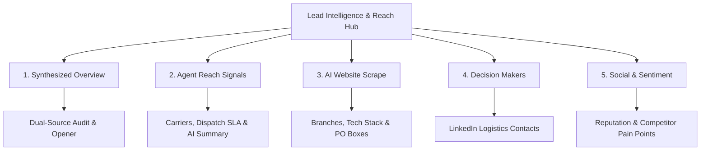

# ProspectPlus Lead Intelligence & Enrichment Guide
**A Comprehensive Operational Manual for Sales Managers & Executive Leadership**

---

## 1. Executive Summary & Purpose

The **Lead Intelligence & Reach Hub** in ProspectPlus is an enterprise-grade automated sales intelligence engine. It combines **AI Website Scraping** with **Agent Reach Live Web & LinkedIn Intelligence** to provide sales representatives with a complete 360-degree commercial and operational snapshot of any prospective business in under 10 seconds.

### Why This Matters for Sales Leadership
- **Zero Manual Pre-Call Research:** Reps spend 100% of their prep time pitching rather than combing through corporate websites, LinkedIn, and ASIC registries.
- **Accurate Logistics Footprint:** Sales reps immediately know what couriers the prospect uses, their dispatch cutoff times, return policies, and warehouse locations.
- **Direct Access to Decision Makers:** Logistics, Warehouse, and Operations managers are identified from LinkedIn with 1-click CRM contact creation.
- **Competitive Leverage:** Public delivery complaints with existing carriers (e.g. Australia Post, StarTrack, Aramex) are detected and surfaced as high-converting sales hooks.

---

## 2. Where It Is Located on the Lead Profile Page

To access lead intelligence on any lead:

1. Open the Lead Profile in ProspectPlus.
2. Click on the **"Discovery"** tab in the main profile navigation.
3. At the very top of the Discovery view, you will find the **Lead Intelligence & Reach Hub** card.

```
┌──────────────────────────────────────────────────────────────────────────────────────────────────────┐
│  Lead Intelligence & Reach Hub   [✓ Enriched (AI)]  [✓ Agent Reach (Live)]                           │
│  AI website classification, physical branches, PO boxes, live logistics, LinkedIn & sentiment.       │
│                                                                                                      │
│  [ ✨ Run Complete Intel (AI + Agent Reach) ]    [ 👥 Decision Makers (6) ]                           │
├──────────────────────────────────────────────────────────────────────────────────────────────────────┤
│  [ 📑 Synthesized Overview ]  [ 🌐 AI Website Scrape ]  [ 🧭 Agent Reach Signals ]                   │
│  [ 👥 Decision Makers (6) ]   [ 💬 Social & Sentiment ]                                              │
└──────────────────────────────────────────────────────────────────────────────────────────────────────┘
```

---

## 3. How Leads Can Be Enriched (3 Easy Workflows)

ProspectPlus offers three flexible ways to enrich leads, supporting both individual deep dives and high-volume sales campaigns:

### Method 1: On-Demand from the Lead Profile (1-Click)
- **Where:** Lead Profile -> **Discovery** tab -> Top Right of the Hub.
- **Action:** Click **`[✨] Run Complete Intel (AI + Agent Reach)`**.
- **What Happens:** The system simultaneously fires:
  1. The **AI Website Crawler** to extract tech stacks, storefronts, branch networks, and company details.
  2. The **Agent Reach Live Engine** (Exa + LinkedIn) to index active courier policies, dispatch cutoff windows, warehouse locations, and key logistics decision makers.
- **Time:** ~5 to 8 seconds. A unified progress indicator keeps reps informed.

### Method 2: Batch Enrichment from the Outbound Leads Table
- **Where:** Main **Outbound Leads** Table (`/leads`).
- **Action:** Select multiple leads using the checkboxes (or select all filtered leads) -> Click **"Enrich with AI"** in the top action bar.
- **What Happens:** The background worker runs batch crawling and Agent Reach indexing across all selected prospects, automatically tagging them as `Enriched (AI)` and updating their metrics.

### Method 3: Dedicated Decision Maker Search Modal
- **Where:** Click **`[👥] Decision Makers ({count})`** in the Hub header.
- **Action:** Reps can view all indexed LinkedIn candidates, search for new key contacts, and click **`+ Add to Contacts`** to instantly save them to the lead's permanent CRM contact directory.

---

## 4. What Information Is Captured & Shown (5 Specialized Views)

The Hub organizes captured intelligence into **5 dedicated tabs**:



---

### Tab 1: Synthesized Overview (Dual-Source Executive Snapshot)
*The default view designed for a sales rep's 30-second pre-call scan.*

| Field / Component | Description | Sales Rep Value |
| :--- | :--- | :--- |
| **Top Decision Maker Callout** | Highlights the highest-matching operational contact with their exact title and direct `Add to Contacts` action. | Reps know immediately whom to ask for by name. |
| **Dual-Source Comparison Grid** | Side-by-side comparison between **AI Website Scrape** and **Agent Reach Live Signals**. | Instant verification that data is fresh and corroborated across multiple channels. |
| **Suggested Call Opener** | AI-generated opening sentence referencing the prospect's real carrier and dispatch setup. | Replaces generic pitch scripts with immediate credibility. |
| **Sales Talking Points** | 3–4 tailored bullet points based on the prospect's actual operations. | Gives reps high-impact talking points tailored for MailPlus. |
| **CRM Social Proof Match** | Automatically identifies similar signed MailPlus customers in the same industry and suburb. | Reps can drop familiar local brand names during the call. |

---

### Tab 2: Agent Reach Signals (Live Logistics & Courier Evidence)
*Real-time intelligence indexed from Australian web pages, shipping policies, and distribution depots.*

| Metric / Section | Information Captured | Example |
| :--- | :--- | :--- |
| **Detected Parcel Carriers** | Identifies existing courier services mentioned in checkout or returns. | `Australia Post`, `StarTrack`, `Sendle`, `Aramex` |
| **Daily Dispatch Cutoff** | Exact advertised order cutoff time for same-day dispatch. | `2:00 PM AEST`, `Same day if ordered before 12pm` |
| **Verified Web Domain** | Clean, verified corporate domain URL. | `proudpoppyclothing.com.au` |
| **AI Shipping Policy & Carrier Summary** | Gemini Flash synthesizes complex, verbose web pages into a **4-bullet executive brief**: <br>• **Dispatch & Warehousing:** Fulfillment locations, dispatch SLA.<br>• **Carriers & Delivery:** Active shipping services and coverage.<br>• **Returns & Exchanges:** Return window and exchange fees.<br>• **Sales Angle:** Recommended MailPlus service fit. | *Dispatches within 24h from Burleigh Heads (QLD) & Epping (VIC). High parcel volume across 6 stores makes them prime for daily driver pickups.* |
| **Collapsible Source Drawer** | Expandable disclosure containing exact raw excerpts from Exa semantic search. | Auditable proof if reps need to double-check terms. |

---

### Tab 3: AI Website Scrape (Commercial Footprint & Tech Stack)
*Full-fidelity technical and commercial crawl of the prospect's digital presence.*

| Intelligence Category | What Is Captured & Displayed |
| :--- | :--- |
| **Industry Classification** | Broad industry category & sub-category (e.g. `Retail & Consumer Goods` -> `Women's Apparel & Accessories`). |
| **Storefront & Tech Stack** | Identifies eCommerce carts (`Shopify`, `WooCommerce`, `BigCommerce`, `Magento`) and accounting software (`Xero`, `MYOB`). Directly aligns with MailPlus ShipMate integrations. |
| **Physical Branch Network** | Full Australian state-by-state list of physical stores, retail outlets, and distribution centers with street address, suburb, state, postcode, and direct phone numbers. Filterable by state (VIC, NSW, QLD, WA, SA, TAS). |
| **PO Box & Postal Addresses** | Complete list of all corporate PO Boxes, Locked Bags, and GPO Boxes—ideal for MailPlus daily postal exchange services. |
| **Company Profiling** | Target audience, core value proposition, product categories, and business model (B2B, B2C, Hybrid). |
| **Sister Companies & Linked Entities** | Identifies affiliated brands, subsidiary storefronts, and third-party logistics (3PL) partners. |

---

### Tab 4: Key Decision Makers (LinkedIn Real-Time Index)
*Live LinkedIn search targeting Logistics, Warehouse, and Operational leaders.*

```
┌─────────────────────────────────────────────────────────────────────────────┐
│  Kerrie Nelson  [High Match]                                           [↗]  │
│  General Manager at Proud Poppy Clothing                                    │
│  [ Operations & Management ]                                                │
│  ─────────────────────────────────────────────────────────────────────────  │
│  📍 Melbourne, Australia                           [ + Add to Contacts ]    │
└─────────────────────────────────────────────────────────────────────────────┘
```

- **Targeted Roles:** General Managers, Logistics Managers, Warehouse Supervisors, Operations Directors, Supply Chain Coordinators, and Business Owners.
- **Match Confidence:** `High Match` badges highlight primary operational signatories.
- **Direct LinkedIn Links:** Single-click external icon opens their verified LinkedIn profile.
- **One-Click Contact Creation:** Clicking **`Add to Contacts`** immediately adds the person to the lead's CRM contacts directory with name, title, and LinkedIn URL. Once added, the button smoothly transitions to `[✓ In Contacts]`.

---

### Tab 5: Social & Sentiment (Public Reputation & Courier Pain Points)
*Live social monitoring to identify competitor service failures.*

- **Social Profiles:** Instagram, Facebook, and LinkedIn handles with active follower counts.
- **Customer Delivery Sentiment:** Ratings from `Positive`, `Neutral`, to `Negative / Delivery Complaints Detected`.
- **Competitor Delivery Complaints:** Surfaces public customer reviews mentioning parcel delays, damaged boxes, or missing deliveries caused by Australia Post or other competitors.
- **The Sales Edge:** When complaints are flagged, reps have immediate ammunition to offer MailPlus's guaranteed driver afternoon pickups, direct phone support, and loss prevention satchels.

---

## 5. Sales Rep Best Practice Playbook

Sales Managers should train reps to follow this **30-Second Pre-Call Routine**:

```
[ Step 1: Open Discovery Tab ]
            │
            ▼
[ Step 2: Check Detected Carriers & Dispatch Cutoff ] ──> Know who they ship with
            │
            ▼
[ Step 3: Check Top Decision Maker ] ──────────────────> Know who to ask for (Click "+ Add to Contacts")
            │
            ▼
[ Step 4: Scan AI Shipping Summary ] ──────────────────> Spot warehouses, returns fee, and volume
            │
            ▼
[ Step 5: Read Suggested Opener & Dial ] ─────────────> Confident, tailored cold call
```

### Script Example:
> *"Hi Kerrie, it's Alex calling from MailPlus. I noticed Proud Poppy dispatches daily from your Burleigh Heads and Epping fulfillment hubs with Australia Post—we run dedicated daily afternoon driver collections and flat-rate express satchels for Aussie fashion brands in Melbourne. I wanted to see if accommodating later cutoff collections would take some pressure off your warehouse team?"*

---

## 6. Technical & Security Notes
- **Live Search Engine:** Powered by Exa neural search and LinkedIn profile indexing via Agent Reach.
- **AI Synthesis:** Powered by Google Gemini Flash via Genkit for fast, hallucination-free summarization.
- **Data Persistence:** All extracted data is saved to Firestore under `discoveryData.agentReachDossier`, guaranteeing instant page loads on repeat visits without re-incurring API calls.
- **Secrets Management:** `EXA_API_KEY` and `GEMINI_API_KEY` are secured via Google Cloud Secret Manager on Firebase App Hosting.
