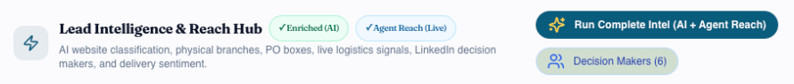
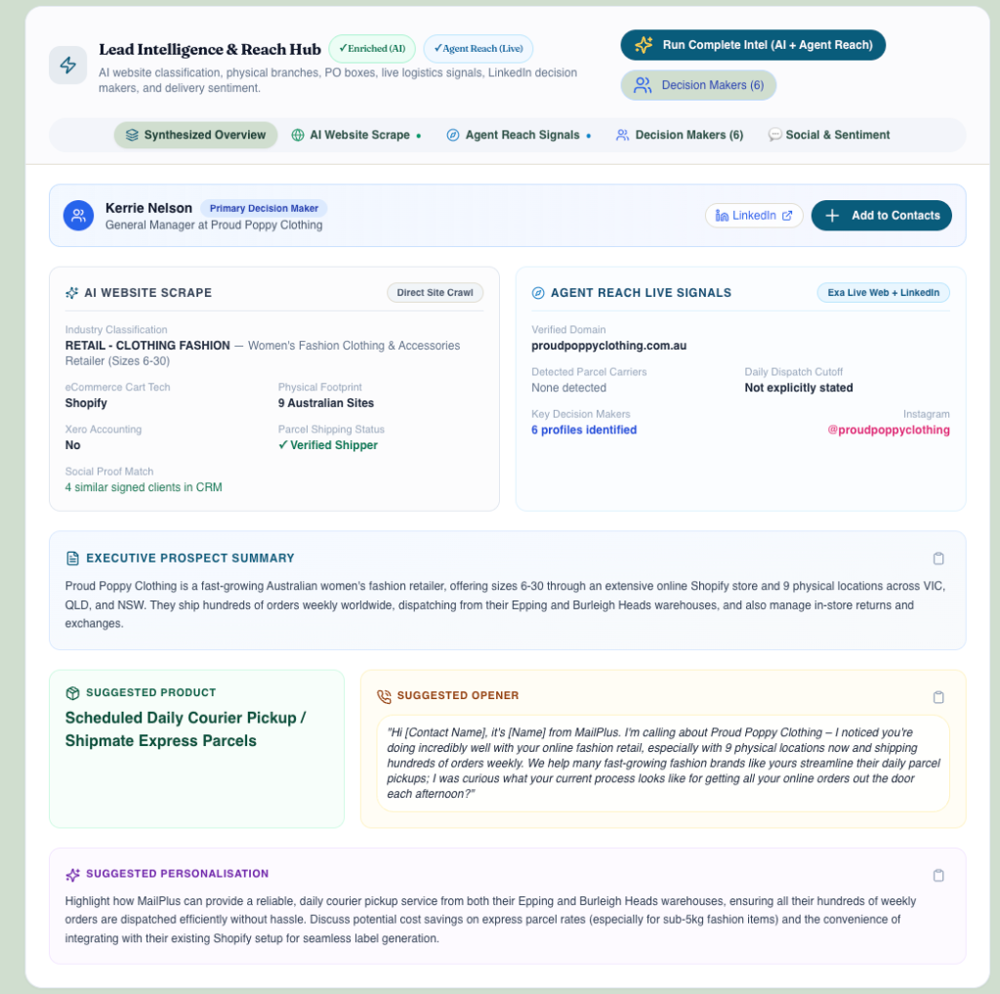
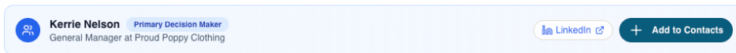
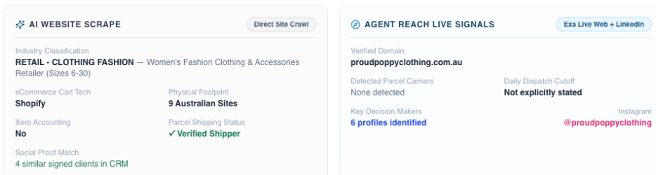
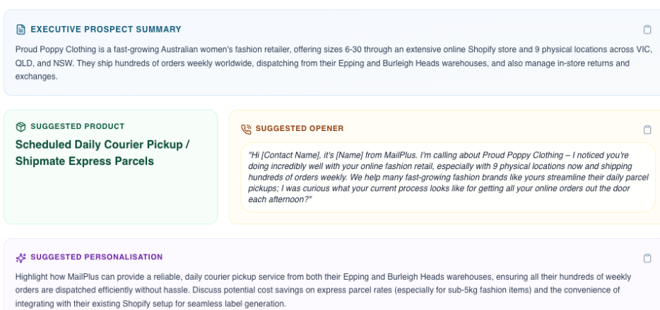
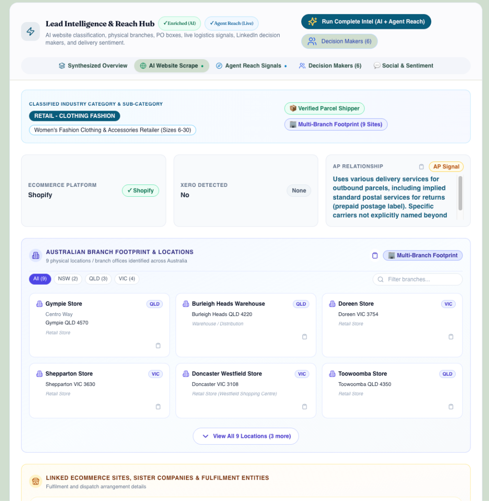
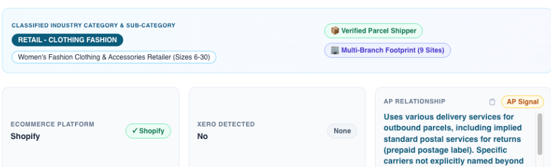
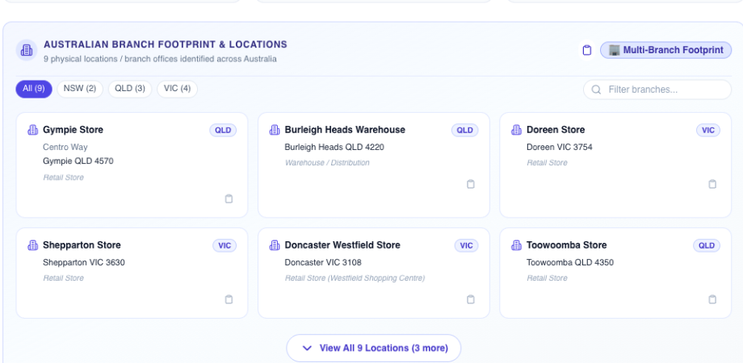
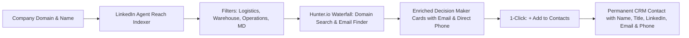

# ProspectPlus Lead Intelligence & Enrichment Guide
**A Comprehensive Operational Manual for Sales Managers & Executive Leadership**

---

## 1. Executive Summary & Objective

The **Lead Intelligence & Reach Hub** in ProspectPlus is an enterprise-grade automated sales intelligence engine. It combines **AI Website Scraping** with **Agent Reach Live Web & LinkedIn Intelligence** to provide sales representatives with a complete 360-degree commercial and operational snapshot of any prospective business in under 10 seconds.

### Why This Matters for Sales Leadership
- **Zero Manual Pre-Call Research:** Reps spend 100% of their prep time pitching rather than combing corporate websites, LinkedIn, and registers.
- **Accurate Courier & Dispatch Footprint:** Instantly reveals existing couriers (e.g., Australia Post, StarTrack, Sendle, Aramex), daily order cutoff times, return policies, and warehouse locations.
- **Direct Access to Operational Decision Makers:** Surfaces Logistics, Warehouse, Operations, and Supply Chain managers from LinkedIn with 1-click addition to CRM contacts.
- **Competitive Pain-Point Leverage:** Detects and flags public delivery complaints with competitor couriers, arming reps with immediate conversion hooks.

---

## 2. Visual Tour: Where Enriched Data Lives

To access enriched data on any lead in ProspectPlus:
1. Open the Lead record in the CRM (`/leads/[leadId]`).
2. Navigate to the **"Discovery"** tab in the main lead profile navigation.
3. The **Lead Intelligence & Reach Hub** is positioned prominently at the top of the tab.

```
┌─────────────────────────────────────────────────────────────────────────────────────────────────────────┐
│  Lead Intelligence & Reach Hub   [✓ Enriched (AI)]  [✓ Agent Reach (Live)]                              │
│  AI website classification, physical branches, PO boxes, live logistics signals, LinkedIn decision       │
│  makers, and delivery sentiment.                                                                        │
│                                                                                                         │
│                              [ ✨ Run Complete Intel (AI + Agent Reach) ]                                │
│                              [ 👥 Decision Makers (6) ]                                                 │
├─────────────────────────────────────────────────────────────────────────────────────────────────────────┤
│  [ 📑 Synthesized Overview ]  [ 🌐 AI Website Scrape • ]  [ 🧭 Agent Reach Signals • ]                  │
│  [ 👥 Decision Makers (6) ]   [ 💬 Social & Sentiment ]                                                 │
└─────────────────────────────────────────────────────────────────────────────────────────────────────────┘
```

---

### Screenshot 1: Hub Header & Consolidated Action Triggers
The top right of the Hub features two streamlined, high-contrast action triggers:



1. **`[✨ Run Complete Intel (AI + Agent Reach)]` (Dark Teal Pill):** The unified master enrichment button. Simultaneously executes the AI Website Scraper and Agent Reach live web/LinkedIn indexing in parallel in 5–8 seconds.
2. **`[👥 Decision Makers (6)]` (Light Slate Pill):** Dedicated shortcut opening the LinkedIn operational candidate drawer and contact creation directory.

---

### Screenshot 2: Synthesized Overview (The 30-Second Pre-Call Screen)
The default landing view, designed specifically for rapid sales rep orientation before dialing:



This synthesized screen consolidates five critical selling assets into a single view:
1. **Primary Decision Maker Banner:** Instantly presents the top operational executive with direct LinkedIn access and 1-click CRM contact sync.
2. **Dual Intelligence Comparison Grid:** Side-by-side comparison of deep website crawler data against live external web & LinkedIn signals.
3. **Executive Prospect Summary:** Concise narrative covering business size, online sales volume, physical store presence, and warehouse locations.
4. **Suggested Product & Call Opener:** Tailored conversation starter referencing their specific order volume, multi-store logistics, and daily dispatch needs.
5. **Suggested Personalisation:** Actionable guidance on pitching MailPlus daily driver pickups and sub-5kg flat-rate satchel savings.

---

### Screenshot 3: Primary Decision Maker & 1-Click CRM Contact Sync
Positioned at the top of the Synthesized Overview for zero-click visibility:



- **Targeted Operational Executive:** Displays full name and title (e.g., `Kerrie Nelson — General Manager at Proud Poppy Clothing`).
- **`[Primary Decision Maker]` Badge:** Highlights the key individual who holds operational and budget authority.
- **`[LinkedIn ↗]` Button:** One-click direct link to view their verified professional LinkedIn profile in a new tab.
- **`[+ Add to Contacts]` Button:** Prominent dark teal button with crisp white typography. Clicking it immediately creates a permanent contact record in the CRM's **Contacts** tab and updates the button to `[✓ In Contacts]`.

---

### Screenshot 4: Dual Intelligence Comparison Grid
Juxtaposes website crawl data against real-time external web intelligence:



- **AI Website Scrape (Direct Site Crawl):**
  - **Industry Classification:** Granular industry tag (e.g., `RETAIL - CLOTHING FASHION — Women's Fashion Clothing & Accessories Retailer (Sizes 6-30)`).
  - **eCommerce Cart Tech:** Detected store platform (e.g., `Shopify`), confirming instant integration with the free MailPlus ShipMate shipping app.
  - **Physical Footprint:** Count of physical locations identified across Australia (e.g., `9 Australian Sites`).
  - **Parcel Shipping Status:** Automated badge confirming whether the company actively ships physical packages (`✓ Verified Shipper`).
  - **Social Proof Match:** Automatically cross-references CRM accounts to show signed MailPlus customers in the same industry vertical (e.g., `4 similar signed clients in CRM`).
- **Agent Reach Live Signals (Exa Live Web + LinkedIn):**
  - **Verified Domain:** Canonical root domain validated against registries (`proudpoppyclothing.com.au`).
  - **Detected Parcel Carriers & Cutoff:** Flags current couriers (e.g., Australia Post, StarTrack) and daily dispatch order cutoffs.
  - **Key Decision Makers Count:** Total operational profiles indexed on LinkedIn (`6 profiles identified`).
  - **Social Handle:** Direct link to active Instagram profile (`@proudpoppyclothing`) for volume sizing.

---

### Screenshot 5: Executive Summary, Suggested Opener & Personalisation
Provides sales reps with high-converting conversation openers tailored to the prospect's real logistics:



- **Executive Prospect Summary:** Explains how the company operates, where they fulfill orders (e.g., Epping and Burleigh Heads warehouses), and that they ship hundreds of parcels weekly worldwide.
- **Suggested Product:** The exact MailPlus offering to lead with (e.g., `Scheduled Daily Courier Pickup / Shipmate Express Parcels`).
- **Suggested Opener:** Word-for-word cold call script ready to be delivered:
  > *"Hi [Contact Name], it's [Name] from MailPlus. I'm calling about Proud Poppy Clothing — I noticed you're doing incredibly well with your online fashion retail, especially with 9 physical locations now and shipping hundreds of orders weekly. We help many fast-growing fashion brands like yours streamline their daily parcel pickups; I was curious what your current process looks like for getting all your online orders out the door each afternoon?"*
- **Suggested Personalisation:** Tactical guidance highlighting dual-warehouse pickups, Shopify label printing integration, and sub-5kg satchel volume savings.

---

### Screenshot 6: AI Website Scrape — Classification, eCommerce & AP Relationship
Clicking the **`[🌐 AI Website Scrape •]`** sub-navigation pill opens the full deep-crawl breakdown:





- **Classified Industry Category & Sub-Category:** High-fidelity vertical categorization with `[📦 Verified Parcel Shipper]` and `[🏢 Multi-Branch Footprint (9 Sites)]` verification badges.
- **eCommerce & Accounting Stack:** Identifies cart infrastructure (`Shopify`) and accounting software (`Xero`, `MYOB`).
- **Australia Post (AP) Relationship Signal:** Analyzes shipping policies and customer returns to identify existing postal arrangements, including prepaid return satchels and drop-off habits.

---

### Screenshot 7: Australian Branch Footprint & Location Directory
Visualizes all physical stores and fulfillment centers identified across Australia:



- **State-by-State Filtering:** Instant filter pills for `[All (9)]`, `[NSW (2)]`, `[QLD (3)]`, `[VIC (4)]`, plus a live keyword search bar.
- **Warehouse vs. Retail Differentiation:** Distinguishes commercial distribution hubs (e.g., *Burleigh Heads Warehouse — Warehouse / Distribution*) from storefronts (e.g., *Doncaster Westfield Store — Retail Store*).
- **Multi-Location Logistics Pitch:** Reps can pitch centralized warehouse daily driver collections alongside scheduled inter-store satchel transfers.

---

## 3. Complete Enriched Fields Reference Table

Below is the complete directory of all 27 data fields captured during enrichment, where each field appears on the Lead Profile, its internal CRM field path, and its strategic utility for sales reps:

| # | Display Label / Field | UI Location in Profile | Internal CRM Field Path | Data Source | Example Value | Sales Rep Utility & Strategy |
| :- | :--- | :--- | :--- | :--- | :--- | :--- |
| **1** | **Enriched (AI) Badge** | Hub Header | `discoveryData.lastEnriched` | AI Crawler | `✓ Enriched (AI)` | Visual confirmation that website crawl and industry classification are complete. |
| **2** | **Agent Reach (Live) Badge** | Hub Header | `discoveryData.agentReachDossier.generatedAt` | Agent Reach | `✓ Agent Reach (Live)` | Visual confirmation that live web logistics and LinkedIn search are active. |
| **3** | **Primary Decision Maker** | Overview & Decision Makers | `discoveryData.agentReachDossier.decisionMakers[0]` | LinkedIn Index | `Kerrie Nelson — General Manager` | Reps know exactly who runs company operations before dialing. |
| **4** | **Match Confidence** | Overview & Decision Makers | `candidate.confidence` | LinkedIn Index | `Primary Decision Maker` / `High Match` | Prioritizes operational signatories over administrative staff. |
| **5** | **LinkedIn Direct URL** | Overview & Decision Makers | `candidate.linkedinUrl` | LinkedIn Index | `linkedin.com/in/...` | 1-click external link to view employment background and mutual connections. |
| **6** | **Suggested Call Opener** | Synthesized Overview | `discoveryData.agentReachDossier.enrichment.suggestedOpener` | Gemini Synthesis | *"Hi [Name], it's [Rep] with MailPlus. I noticed Proud Poppy dispatches daily..."* | High-credibility conversation hook tailored to shipping setup and store footprint. |
| **7** | **Suggested Product** | Synthesized Overview | `discoveryData.suggestedProduct` | Gemini Synthesis | `Scheduled Daily Courier Pickup / Shipmate Express Parcels` | The exact MailPlus core service to quote and pitch on the initial call. |
| **8** | **Suggested Personalisation** | Synthesized Overview | `discoveryData.suggestedPersonalisation` | Gemini Synthesis | Multi-warehouse collection (Epping & Burleigh Heads) + Shopify integration | Eliminates rep hesitation; gives concrete talking points for MailPlus value props. |
| **9** | **Executive Prospect Summary** | Synthesized Overview | `discoveryData.prospectSummary` | Gemini Flash | Fast-growing women's fashion retailer with 9 sites and dual warehouse hubs | Gives reps commercial context on products, parcel volume, and fulfillment setup. |
| **10** | **Social Proof Signed Clients** | Synthesized Overview | `similarCustomers` | CRM Matcher | `4 similar signed clients in CRM` | Reps can drop familiar local customer names in the same industry vertical. |
| **11** | **Detected Parcel Carriers** | Agent Reach & Overview | `discoveryData.agentReachDossier.logisticsSignals.carrierDetected` | Exa Web Discovery | `Australia Post`, `StarTrack`, `Sendle` | Identifies incumbent courier contract to prepare rate and service comparisons. |
| **12** | **Daily Dispatch Cutoff** | Agent Reach & Overview | `discoveryData.agentReachDossier.logisticsSignals.cutoffTimes` | Exa Web Discovery | `2:00 PM AEST` | Reps pitch later afternoon pickup times to extend the prospect's daily selling window. |
| **13** | **Verified Web Domain** | Agent Reach & Overview | `discoveryData.agentReachDossier.verifiedDomain` | Exa Domain Engine | `proudpoppyclothing.com.au` | Clean canonical domain verified against corporate business registrations. |
| **14** | **Verified Parcel Shipper** | AI Scrape & Overview | `discoveryData.parcelShippingStatus` | AI Crawler | `✓ Verified Shipper` | Validates that prospect ships physical parcels and is eligible for courier accounts. |
| **15** | **AI Shipping Summary** | Agent Reach Tab | `discoveryData.agentReachDossier.logisticsSignals.shippingSummary` | Gemini Flash | 4-point bulleted breakdown of fulfillment, carriers, returns, and sales angle | Replaces walls of raw text with an executive brief scannable in 5 seconds. |
| **16** | **Raw Source Citations** | Agent Reach (Drawer) | `discoveryData.agentReachDossier.logisticsSignals.rawSnippets` | Exa Search | Exact quotes from shipping policy & terms pages | Auditable source evidence if reps need to verify exact legal or return terms. |
| **17** | **Industry Category** | AI Scrape & Overview | `discoveryData.industryCategory` | AI Crawler | `RETAIL - CLOTHING FASHION` | Categorizes the business vertical for targeted sales campaigns and reporting. |
| **18** | **Industry Sub-Category** | AI Scrape & Overview | `discoveryData.industrySubCategory` | AI Crawler | `Women's Fashion Clothing & Accessories Retailer (Sizes 6-30)` | Granular niche classification for precision pitch framing. |
| **19** | **eCommerce Cart Platform** | AI Scrape & Overview | `discoveryData.ecommercePlatform` | AI Crawler / Exa | `Shopify` (or WooCommerce, BigCommerce, Magento) | Informs reps that prospect is plug-and-play compatible with free MailPlus ShipMate app. |
| **20** | **Xero Accounting Detected** | AI Scrape & Overview | `discoveryData.xeroDetected` | AI Crawler | `No` / `Yes` | Verifies automated paperless billing and electronic invoicing compatibility. |
| **21** | **Australia Post (AP) Signal**| AI Website Scrape Tab | `discoveryData.apRelationshipSignal` | AI Crawler | Uses various delivery services; prepaid postal return labels | Arms reps with intelligence on the prospect's current postal dependence. |
| **22** | **Physical Branch Network** | AI Scrape & Footprint | `discoveryData.branches` | AI Crawler | 9 locations across NSW, QLD, and VIC with addresses and store types | Identifies warehouse distribution centers vs retail stores for multi-site collection. |
| **23** | **PO Box & Postal Addresses** | AI Website Scrape Tab | `discoveryData.postalAddresses` | AI Crawler | Corporate PO Boxes and Locked Bags | Prime target for MailPlus daily postal collection and GPO lodge runs. |
| **24** | **Permanent CRM Contact** | Contacts Tab & Header | `contacts[]` | 1-Click Sync | Synced contact record in lead's directory | Saves contact permanently with name, title, email/LinkedIn for dialing and cadence. |
| **25** | **Social Handles & Followers** | Social & Sentiment Tab | `discoveryData.socialIntelligence` | Social Indexer | `@proudpoppyclothing` on Instagram, Facebook followers | Indicator of online brand popularity, consumer engagement, and parcel order volume. |
| **26** | **Shipping Sentiment Rating** | Social & Sentiment Tab | `discoveryData.socialIntelligence.shippingSentiment` | Social Monitor | `Negative / Delivery Complaints Detected` | Flags whether current carrier is failing customers with late or lost parcels. |
| **27** | **Competitor Delivery Complaints** | Social & Sentiment Tab | `discoveryData.socialIntelligence.deliveryComplaints` | Social Monitor | Customer reviews citing parcel delivery delays or lost boxes with competitor couriers | Reps position MailPlus guaranteed daily driver care as direct solution to customer churn. |

---

## 4. Deep Dive: Finding Contacts from LinkedIn & Hunter.io Email/Phone Waterfall

Finding the right operational person is the single highest-value step in outbound B2B courier sales. The Hub completely automates this workflow by combining LinkedIn profile discovery with Hunter.io contact waterfall enrichment:



### 1. How It Works
- When **Run Complete Intel** or **Decision Makers** is triggered, Agent Reach queries live LinkedIn indexes targeting:
  - **Logistics & Dispatch:** Logistics Managers, Dispatch Coordinators, Shipping Supervisors.
  - **Warehouse & Fulfillment:** Warehouse Managers, Fulfillment Directors, Distribution Leads.
  - **Executive Operations:** Operations Directors, General Managers, Managing Directors, Founders.
- Extracted details include **Full Name**, **Current Title**, **Department Tag** (e.g. *Operations & Management*), and **Location** (e.g. *Melbourne, Australia*).

### 2. Automated Hunter.io Email & Direct Phone Waterfall
- Simultaneously with the LinkedIn discovery, the system queries the **Hunter.io Domain Search and Email Finder APIs** using the prospect's verified corporate domain (`HUNTER_API_KEY`):
  - **Domain-Level Cache Search:** Queries known emails for the domain and matches them against discovered LinkedIn candidates.
  - **Targeted Email Finder Fallback:** For top primary decision-makers not in the domain list, queries Hunter's Email Finder to look up the exact work email.
  - **Discovered Fields:** Returns the verified work email address, deliverability confidence score (e.g. `94%`), and direct phone number if on file.

### 3. Match Confidence & Verification
- **Role Authority:** Primary operational signatories receive `Primary Decision Maker` or `High Match` badges.
- **Direct LinkedIn Verification:** Reps can click `[LinkedIn ↗]` to open their live profile in a new tab.
- **Deliverability Badge:** Verified emails display confidence scores (e.g., `94%`) so reps know the inbox is active before sending proposals.

### 4. 1-Click Permanent CRM Contact Creation (Zero Data Entry)
- When reps click **`+ Add to Contacts`** (styled in high-contrast dark teal `#095c7b` with white text):
  - The contact record is saved in the CRM with **Full Name**, **Job Title**, **LinkedIn URL**, **Verified Work Email**, and **Direct / Company Phone**.
  - Reps never have to copy-paste or manually type contact information.
  - The button transitions into a green **`[✓ In Contacts]`** status badge to prevent duplicate records.

### 5. On-Demand Re-Scanning
- If a company recently restructured or appointed a new supply chain head, reps can click **`Re-scan LinkedIn`** inside the Decision Makers view to refresh results immediately.

---

## 5. Deep Dive: Social Footprint & Courier Sentiment Tracking

The **Social & Sentiment** view provides reps with an intelligence wedge against competitor carriers:

### 1. Brand Footprint & Volume Sizing
- Detects the prospect's **Instagram**, **Facebook**, and **LinkedIn** company pages along with their follower counts (e.g., `@proudpoppyclothing`).
- **Why It Matters:** An online apparel or lifestyle brand with tens of thousands of followers is virtually guaranteed to dispatch hundreds of parcels weekly, indicating high revenue potential for MailPlus satchels.

### 2. Delivery Sentiment Rating
- The system scans recent public consumer feedback, reviews, and comments relating to parcel delivery, classifying sentiment as:
  - `Positive`: Customers praise quick turnaround.
  - `Neutral`: Standard transactional chatter.
  - `Negative / Delivery Complaints Detected`: Public customer frustration over courier service.

### 3. Surfacing Competitor Courier Failures
- The engine specifically flags mentions of **lost parcels**, **extended delivery delays**, **damaged boxes**, or **unresponsive customer support** associated with Australia Post, StarTrack, Aramex, or Sendle.
- **How Reps Pitch This:**
  > *"Kerrie, I noticed on your public channels that your team has had to deal with customer complaints regarding delayed courier deliveries during peak promotions. With MailPlus, your parcels are handed directly to your dedicated local franchise driver every afternoon, backed by our direct phone support so your team never has to wait on courier call-center hold lines again."*

---

## 6. How Leads Can Be Enriched (3 Operating Workflows)

### Method 1: 1-Click from the Lead Profile
- Open any lead record -> Go to **Discovery** tab -> Click **`[✨ Run Complete Intel (AI + Agent Reach)]`**.
- Simultaneously executes website crawling and live web/LinkedIn indexing in 5–8 seconds.

### Method 2: Targeted Decision Maker Discovery Modal
- Click **`[👥 Decision Makers (6)]`** in the Hub header.
- Opens the dedicated modal to discover, review, and add key managers directly into contacts without leaving the current screen.

### Method 3: Batch Enrichment from Outbound Leads Table
- Go to the main **Outbound Leads Table** (`/leads`).
- Check multiple leads (or select an entire filtered segment) -> Click **"Enrich with AI"** in the action bar.
- Runs asynchronous batch crawling and Agent Reach indexing across all selected prospects.

---

## 7. The 30-Second Pre-Call Routine for Sales Reps

```
[ Step 1: Open Discovery Tab ]
            │
            ▼
[ Step 2: Check Detected Carriers & Cutoff ] ──> Know who they ship with & when orders close
            │
            ▼
[ Step 3: Identify Primary Decision Maker ] ────> Know who to ask for (Click "+ Add to Contacts")
            │
            ▼
[ Step 4: Scan Executive Prospect Summary ] ───> Note warehouses (e.g. Epping & Burleigh Heads)
            │
            ▼
[ Step 5: Read Suggested Opener & Dial ] ──────> Deliver a warm, confident, customized pitch
```

---

## 8. Technical Architecture & Security Notes
- **Neural Web Search:** Powered by Exa API for real-time semantic discovery across Australian business registries, courier policies, and LinkedIn.
- **Generative AI Inference:** Google Gemini Flash configured via Genkit for deterministic, hallucination-free summarization.
- **Firestore Caching:** All intelligence dossiers are persisted under `discoveryData.agentReachDossier`, guaranteeing instant page loads on repeat visits without re-incurring API costs.
- **Enterprise Security:** API keys (`EXA_API_KEY`, `GEMINI_API_KEY`) are managed securely via Google Cloud Secret Manager on Firebase App Hosting.
