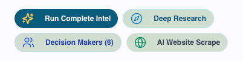
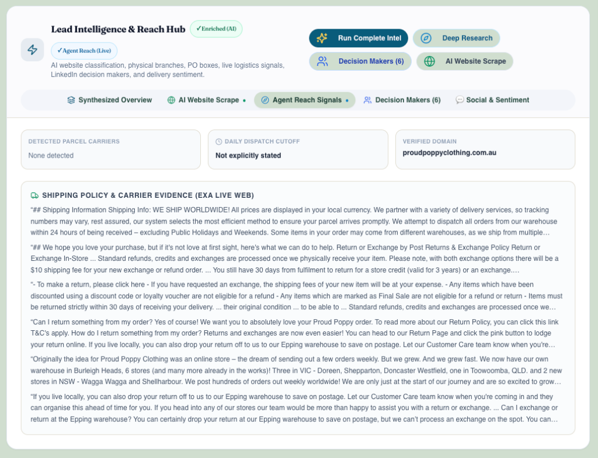
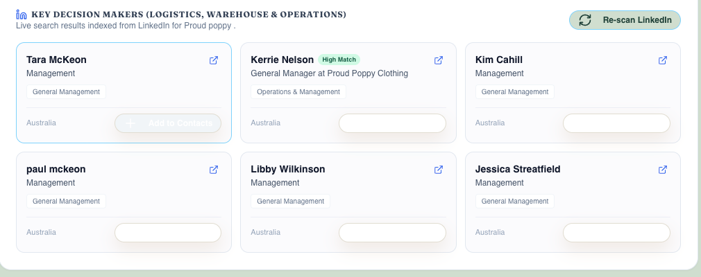
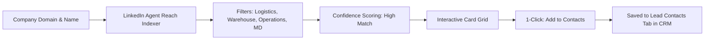

# ProspectPlus Lead Intelligence & Enrichment Guide
**A Comprehensive Operational Manual for Sales Managers & Executive Leadership**

---

## 1. Executive Summary & Objective

The **Lead Intelligence & Reach Hub** in ProspectPlus is an enterprise-grade automated sales intelligence engine. It combines **AI Website Scraping** with **Agent Reach Live Web & LinkedIn Intelligence** to provide sales representatives with a complete 360-degree commercial and operational snapshot of any prospective business in under 10 seconds.

### Why This Matters for Sales Leadership
- **Zero Manual Pre-Call Research:** Reps spend 100% of their prep time pitching rather than combing corporate websites, LinkedIn, and registers.
- **Accurate Courier & Dispatch Footprint:** Instantly reveals existing couriers (e.g., Australia Post, StarTrack, Sendle, Aramex), daily order cutoff times, return policies, and fulfillment locations.
- **Direct Access to Operational Decision Makers:** Surfaces Logistics, Warehouse, Operations, and Supply Chain managers from LinkedIn with 1-click addition to CRM contacts.
- **Competitive Pain-Point Leverage:** Detects and flags public delivery complaints with competitor couriers, arming reps with immediate conversion hooks.

---

## 2. Visual Tour: Where Enriched Data Lives

To access enriched data on any lead in ProspectPlus:
1. Open the Lead record in the CRM.
2. Navigate to the **"Discovery"** tab in the main lead profile navigation.
3. The **Lead Intelligence & Reach Hub** is positioned prominently at the top of the tab.

```
┌─────────────────────────────────────────────────────────────────────────────────────────────────────────┐
│  Lead Intelligence & Reach Hub   [✓ Enriched (AI)]  [✓ Agent Reach (Live)]                              │
│  AI website classification, physical branches, PO boxes, live logistics, LinkedIn & sentiment.          │
│                                                                                                         │
│  [ ✨ Run Complete Intel (AI + Agent Reach) ]    [ 👥 Decision Makers (6) ]                              │
├─────────────────────────────────────────────────────────────────────────────────────────────────────────┤
│  [ 📑 Synthesized Overview ]  [ 🌐 AI Website Scrape ]  [ 🧭 Agent Reach Signals ]                      │
│  [ 👥 Decision Makers (6) ]   [ 💬 Social & Sentiment ]                                                 │
└─────────────────────────────────────────────────────────────────────────────────────────────────────────┘
```

---

### Screenshot 1: Hub Header & Primary Action Buttons
The top right of the Hub features two consolidated action triggers:



1. **`[✨] Run Complete Intel (AI + Agent Reach)`**: The master enrichment button. Executes both the AI Website Scraper and Agent Reach live web/LinkedIn indexing in parallel in 5–8 seconds.
2. **`[👥] Decision Makers ({count})`**: Dedicated action opening the LinkedIn candidate search and contact creation dialog.

---

### Screenshot 2: Synthesized Overview (The 30-Second Pre-Call Screen)
The default landing view, designed for rapid sales rep orientation before picking up the phone:


- **Top Decision Maker Callout:** Highlights the primary operational signatory with title and direct `+ Add to Contacts` button.
- **Dual-Source Comparison Grid:** Side-by-side audit comparing website crawl results with live Agent Reach web signals.
- **Suggested Call Opener:** Tailored conversation starter referencing their actual carrier and cutoff time.
- **Sales Talking Points:** Bullet points highlighting MailPlus daily driver collections and express flat-rate satchels.
- **Social Proof Match:** Automatically matches similar signed MailPlus customers in the same industry category and suburb.

---

### Screenshot 3: Agent Reach Signals & AI Shipping Policy Summary
Real-time logistics, courier verification, and dispatch SLAs:



- **Detected Parcel Carriers:** Identifies active courier partners (e.g. Australia Post, StarTrack, Aramex).
- **Daily Dispatch Cutoff:** Order cutoff times for same-day dispatch (e.g. `2:00 PM`).
- **AI Shipping Policy & Carrier Summary:** Synthesizes verbose website shipping policies into 4 concise bullet points (Dispatch SLA, Carriers, Returns, and Sales Angle).
- **Collapsible Source Drawer:** Expandable section holding verified web excerpts for full auditability.

---

### Screenshot 4: Key Decision Makers (LinkedIn Real-Time Index)
Live indexed operational personnel with one-click CRM contact sync:



- **Operational Role Targeting:** Logistics Managers, Operations Heads, Warehouse Supervisors, and Founders.
- **Match Confidence:** `High Match` badges highlight primary operational signatories.
- **Direct LinkedIn Links:** Single-click external icon opens their verified LinkedIn profile.
- **One-Click Contact Creation:** `+ Add to Contacts` instantly creates a permanent contact record in the CRM, transitioning to `[✓ In Contacts]`.

---

## 3. Complete Enriched Fields Reference Table

Below is the complete inventory of all data fields captured during enrichment, where each field appears on the Lead Profile, its internal CRM field path, and its strategic utility for sales reps:

| # | Display Label / Field | UI Location in Profile | Internal CRM Field Path | Data Source | Example Value | Sales Rep Utility & Strategy |
| :- | :--- | :--- | :--- | :--- | :--- | :--- |
| **1** | **Enriched (AI) Badge** | Hub Header | `discoveryData.lastEnriched` | AI Crawler | `✓ Enriched (AI)` | Visual indicator that website crawl and industry classification are complete. |
| **2** | **Agent Reach (Live) Badge** | Hub Header | `discoveryData.agentReachDossier.generatedAt` | Agent Reach | `✓ Agent Reach (Live)` | Visual indicator that live web logistics and LinkedIn search are active. |
| **3** | **Top Decision Maker** | Synthesized Overview | `discoveryData.agentReachDossier.decisionMakers[0]` | LinkedIn Index | `Kerrie Nelson - General Manager` | Reps know exactly who runs company operations before dialing. |
| **4** | **Match Confidence** | Synthesized Overview & Decision Makers Tab | `candidate.confidence` | LinkedIn Index | `High Match` | Highlights operational signatories vs general administrative staff. |
| **5** | **Suggested Call Opener** | Synthesized Overview | `discoveryData.agentReachDossier.enrichment.suggestedOpener` | Gemini Synthesis | *"Hi Kerrie, it's Alex with MailPlus. I noticed Proud Poppy dispatches daily using Australia Post..."* | High-credibility, personalized conversation hook tailored to their shipping setup. |
| **6** | **Sales Talking Points** | Synthesized Overview & Agent Reach Tab | `discoveryData.agentReachDossier.enrichment.talkingPoints` | Gemini Synthesis | • Guaranteed afternoon driver collection<br>• Sub-5kg express flat satchels | Eliminates rep hesitation; gives concrete value props for MailPlus. |
| **7** | **Social Proof Signed Clients** | Synthesized Overview | `similarCustomers` | CRM Matcher | `4 signed clients in Women's Apparel (VIC)` | Reps can drop familiar local customer names during cold calls. |
| **8** | **Detected Parcel Carriers** | Agent Reach Tab & Overview | `discoveryData.agentReachDossier.logisticsSignals.carrierDetected` | Exa Web Discovery | `Australia Post`, `StarTrack`, `Sendle` | Identifies incumbent courier contract to prepare rate and service comparisons. |
| **9** | **Daily Dispatch Cutoff** | Agent Reach Tab & Overview | `discoveryData.agentReachDossier.logisticsSignals.cutoffTimes` | Exa Web Discovery | `2:00 PM AEST` | Reps pitch later afternoon pickup times to extend the prospect's daily selling window. |
| **10** | **Verified Web Domain** | Agent Reach Tab & Overview | `discoveryData.agentReachDossier.verifiedDomain` | Exa Domain Engine | `proudpoppyclothing.com.au` | Clean canonical domain verified from corporate registrations. |
| **11** | **AI Shipping Policy Summary** | Agent Reach Tab | `discoveryData.agentReachDossier.logisticsSignals.shippingSummary` | Gemini Flash | 4-point bulleted breakdown of fulfillment, carriers, returns, and opportunity | Replaces walls of raw text with an executive brief scannable in 5 seconds. |
| **12** | **Raw Source Citations** | Agent Reach Tab (Collapsible) | `discoveryData.agentReachDossier.logisticsSignals.rawSnippets` | Exa Search | Exact quotes from shipping policy & terms pages | Auditable source evidence if reps need to verify exact legal or return terms. |
| **13** | **Industry Category** | AI Website Scrape Tab & Overview | `discoveryData.industryCategory` | AI Crawler | `Retail & Consumer Goods` | Categorizes the business vertical for targeted sales campaigns. |
| **14** | **Industry Sub-Category** | AI Website Scrape Tab & Overview | `discoveryData.industrySubCategory` | AI Crawler | `Women's Apparel & Fashion Accessories` | Granular niche classification for precision pitch framing. |
| **15** | **eCommerce Cart Platform** | AI Website Scrape Tab & Overview | `discoveryData.ecommercePlatform` | AI Crawler / Exa | `Shopify` (or WooCommerce, BigCommerce, Magento) | Informs reps that prospect is plug-and-play compatible with free MailPlus ShipMate app. |
| **16** | **Accounting Software** | AI Website Scrape Tab & Overview | `discoveryData.xeroDetected` | AI Crawler | `Xero` (or MYOB) | Verifies automated invoicing and paperless billing integration compatibility. |
| **17** | **Physical Branch Network** | AI Website Scrape Tab | `discoveryData.branches` | AI Crawler | 6 retail stores across VIC, NSW, QLD with street addresses and phone numbers | Identifies multi-location store footprint for potential multi-site pickup agreements. |
| **18** | **PO Box & Postal Addresses** | AI Website Scrape Tab | `discoveryData.postalAddresses` | AI Crawler | Corporate PO Boxes and Locked Bags | Prime target for MailPlus daily postal collection and GPO lodge runs. |
| **19** | **Company Description & Products** | AI Website Scrape Tab & Overview | `discoveryData.prospectSummary` | AI Crawler | Summary of products, pricing, and catalog | Provides reps with instant commercial context on what the company sells. |
| **20** | **Target Audience & Value Prop** | AI Website Scrape Tab | `companyInsights[0].targetAudience` | AI Crawler | Target demographics, size, and brand promise | Helps reps align pitch tone (e.g. boutique, fast-growth, industrial). |
| **21** | **Fulfillment Model** | AI Website Scrape Tab | `discoveryData.fulfilmentModel` | AI Crawler | `In-house warehouse fulfillment` vs `3PL` | Determines whether sales pitch targets their internal warehouse manager or 3PL coordinator. |
| **22** | **Sister Companies & Linked Entities**| AI Website Scrape Tab | `discoveryData.linkedEntities` | AI Crawler | Affiliated brand storefronts, subsidiaries, and sister entities | Uncovers multi-brand cross-selling opportunities under the same ownership. |
| **23** | **LinkedIn Profiles & Titles** | Decision Makers Tab | `discoveryData.decisionMakerCandidates` | LinkedIn Index | Name, exact title, department, location, and URL | Bypasses gatekeepers directly to operational heads. |
| **24** | **Permanent CRM Contact** | Contacts Tab & Header | `contacts[]` | 1-Click Sync | Synced contact record in lead's contact directory | Saves contact permanently with name, title, email/LinkedIn for dialing and cadence. |
| **25** | **Social Handles & Followers** | Social & Sentiment Tab | `discoveryData.socialIntelligence` | Social Indexer | Instagram handle, Facebook page, LinkedIn followers | Indicator of online brand popularity, consumer engagement, and parcel order volume. |
| **26** | **Shipping Sentiment Rating** | Social & Sentiment Tab | `discoveryData.socialIntelligence.shippingSentiment` | Social Monitor | `Negative / Delivery Complaints Detected` | Flags whether current carrier is failing customers. |
| **27** | **Competitor Delivery Complaints** | Social & Sentiment Tab | `discoveryData.socialIntelligence.deliveryComplaints` | Social Monitor | Customer reviews citing parcel delivery delays or lost boxes with competitor couriers | Reps position MailPlus guaranteed daily driver care as direct solution to customer churn. |

---

## 4. Deep Dive: Finding Contacts from LinkedIn

Finding the right operational person is the single highest-value step in outbound B2B courier sales. The Hub completely automates this workflow:



### 1. How It Works
- When **Run Complete Intel** or **Decision Makers** is triggered, Agent Reach queries live LinkedIn indexes targeting:
  - **Logistics & Dispatch:** Logistics Managers, Dispatch Coordinators, Shipping Supervisors.
  - **Warehouse & Fulfillment:** Warehouse Managers, Fulfillment Directors, Distribution Leads.
  - **Executive Operations:** Operations Directors, General Managers, Managing Directors, Founders.
- Extracted details include **Full Name**, **Current Title**, **Department Tag** (e.g. *Operations & Management*), and **Location** (e.g. *Melbourne, Australia*).

### 2. Match Confidence (`High Match` Badge)
- The algorithm scores each profile. Operational roles that control shipping budgets and carrier selection receive a **`High Match`** badge.
- This ensures reps do not waste time calling general office administrators or non-operational staff.

### 3. Direct Profile Verification
- Every card includes a direct external link icon `[↗]`. Reps can click to view the live LinkedIn profile in a new tab to see background, mutual connections, or recent activity.

### 4. 1-Click CRM Contact Creation
- Reps click **`+ Add to Contacts`** on any candidate card.
- The system automatically creates a permanent contact entry in the lead's **"Contacts"** tab with name, job title, and linked profile.
- The button smoothly transforms into a green **`[✓ In Contacts]`** status badge to prevent duplicate additions.

### 5. On-Demand Re-Scanning
- If a company recently restructured or appointed a new supply chain head, reps can click **`Re-scan LinkedIn`** inside the Decision Makers tab to refresh results immediately.

---

## 5. Deep Dive: Social Footprint & Courier Sentiment Tracking

The **Social & Sentiment** view provides reps with an intelligence wedge against competitor carriers:

### 1. Brand Footprint & Volume Sizing
- Detects the prospect's **Instagram**, **Facebook**, and **LinkedIn** company pages along with their follower counts.
- **Why It Matters:** A fashion or consumer brand with 50,000+ Instagram followers is virtually guaranteed to dispatch hundreds of parcels weekly, indicating high revenue potential for MailPlus satchels.

### 2. Delivery Sentiment Rating
- The system scans recent public consumer feedback, reviews, and comments relating to parcel delivery, classifying sentiment as:
  - `Positive`: Customers praise quick turnaround.
  - `Neutral`: Standard transactional chatter.
  - `Negative / Delivery Complaints Detected`: Public customer frustration over courier service.

### 3. Surfacing Competitor Courier Failures
- The engine specifically flags mentions of **lost parcels**, **extended delivery delays**, **damaged boxes**, or **unresponsive customer support** associated with Australia Post, StarTrack, Aramex, or Sendle.
- **How Reps Pitch This:**
  > *"Kerrie, I noticed on your public channels that your team has had to deal with several customer complaints recently regarding delayed Australia Post deliveries during peak promotions. With MailPlus, your parcels are handed directly to your dedicated local franchise driver every afternoon, backed by our direct phone support so your team never has to wait on courier call-center hold lines again."*

---

## 6. How Leads Can Be Enriched (3 Operating Workflows)

### Method 1: 1-Click from the Lead Profile
- Open any lead record -> Go to **Discovery** tab -> Click **`[✨] Run Complete Intel (AI + Agent Reach)`**.
- Simultaneously executes website crawling and live web/LinkedIn indexing in 5–8 seconds.

### Method 2: Batch Enrichment from Outbound Leads Table
- Go to the main **Outbound Leads Table** (`/leads`).
- Check multiple leads (or select an entire filtered segment) -> Click **"Enrich with AI"** in the action bar.
- Runs asynchronous batch crawling and Agent Reach indexing across all selected prospects.

### Method 3: Targeted Decision Maker Discovery Modal
- Click **`[👥] Decision Makers ({count})`** in the Hub header.
- Opens the dedicated modal to discover, review, and add key managers directly into contacts without leaving the current screen.

---

## 7. The 30-Second Pre-Call Routine for Sales Reps

```
[ Step 1: Open Discovery Tab ]
            │
            ▼
[ Step 2: Check Detected Carriers & Cutoff ] ──> Know who they ship with & when orders close
            │
            ▼
[ Step 3: Identify Top Decision Maker ] ───────> Know who to ask for (Click "+ Add to Contacts")
            │
            ▼
[ Step 4: Scan AI Shipping Summary ] ──────────> Note warehouse locations, return terms, volume
            │
            ▼
[ Step 5: Read Suggested Opener & Dial ] ──────> Deliver a warm, confident, customized pitch
```

---

## 8. Technical Architecture & Security Notes
- **Neural Web Search:** Powered by Exa API for real-time semantic discovery across Australian business registries, courier policies, and LinkedIn.
- **Generative AI Inference:** Google Gemini Flash configured via Genkit for deterministic, hallucination-free summarization.
- **Firestore Caching:** All intelligence dossiers are persisted under `discoveryData.agentReachDossier`, guaranteeing instant page loads on repeat visits without re-incurring API costs.
- **Enterprise Security:** API keys (`EXA_API_KEY`, `GEMINI_API_KEY`) are managed securely via Google Cloud Secret Manager on Firebase App Hosting.
