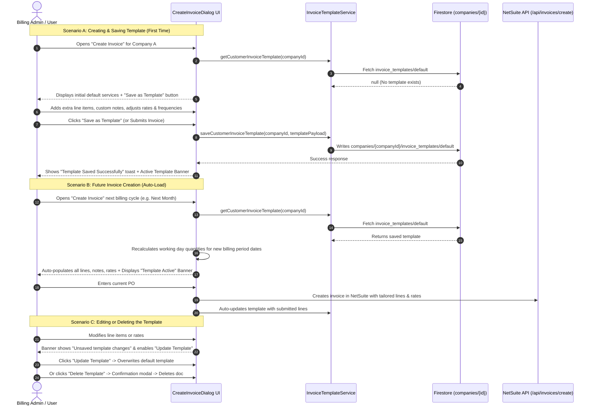

# Implementation Plan - Customer Invoice Template Management

This document outlines the user workflow, technical architecture, data model, and implementation steps for introducing **Customer-Specific Invoice Templates** into ProspectPlus.

---

## 1. Executive Summary & Objectives

Currently, when users open the **Create Invoice Dialog** (`CreateInvoiceDialog`), line items are populated from `company.services` or standard catalog defaults. Any customized line items, specific rates, item details/notes, additional extras, or adjusted admin fee settings have to be manually re-entered every billing cycle.

### Core Objectives:
1. **Save as Template**: Allow users drafting an invoice to save the current configuration (services, extras, frequencies, rates, descriptions, admin fee, and invoice settings) as that customer's reusable template.
2. **Auto-Load on Next Creation**: Next time the user opens the Create Invoice Dialog for that customer, the saved template is automatically loaded.
3. **Dynamic Quantity Recalculation**: For schedule-based lines (e.g., `Mon,Wed,Fri`), quantities are automatically recalculated for the selected billing period based on state public holidays and working days. Non-schedule extras retain their saved template quantities.
4. **Edit & Update**: Users can modify the template anytime and update it with current changes.
5. **Delete Template**: Users can delete the template with a confirmation prompt, returning future invoices to default company services.
6. **Strict 1 Template Per Customer**: Enforce a 1:1 relationship between a customer/company and their invoice template using deterministic Firestore document addressing (`companies/{companyId}/invoice_templates/default`).

---

## 2. User Experience & Step-by-Step Workflow



### Detailed End-User Scenarios

#### 1. Creating & Saving a Template
- The user opens the **Create Customer Invoice** modal from the Customer Profile, Lead Profile, or Customer Invoicing Table.
- The user configures line items (e.g., AMPO Mon/Wed/Fri @ $12.50, PMPO Daily @ $15.00, Additional LPO Bag 2x @ $3.50, internal delivery instructions).
- In the Line Items action header or bottom action bar, the user clicks **"Save as Template"** to save immediately without submitting.
- In addition, whenever the user **submits an invoice** to NetSuite, the template is automatically saved/updated in the background.
- An emerald toast confirms: *"Invoice template saved for [Company Name]"*.
- The UI immediately transforms to display the **Active Template Banner**.

#### 2. Auto-Loading in Subsequent Months
- When opening the modal for that customer in any future billing run:
  - The dialog detects the template and automatically loads it.
  - An **Active Template Banner** appears above the line items:
    ```
    ✦ Saved Template Applied  •  Updated 12 Oct 2026 by Ankith Ravindran
    [Update Template]  [Reset to Defaults]  [Delete Template]
    ```
  - **Dynamic Billable Days Recalculation**: Even though the template was created for a prior month, the dialog evaluates the currently selected billing period (e.g., `01/10/2026` to `31/10/2026`), computes the exact working days for that state's calendar, and sets the fresh quantities and amounts automatically.
  - **Fresh Customer PO**: Per user preference, the Customer PO is left blank so the user can enter the current month's specific PO number.

#### 3. Editing a Template
- If a customer changes their contracted pickup schedule or rates, the user updates the values in the table.
- A subtle indicator appears: `● Unsaved template changes`.
- The user clicks **"Update Template"** (or submits the invoice).
- The template is overwritten with the new rates, items, and frequencies, updating the `updatedAt` and `updatedBy` timestamps.

#### 4. Deleting a Template
- The user clicks **"Delete Template"**.
- A confirmation `AlertDialog` appears:
  > **Delete Invoice Template?**  
  > *This will permanently remove the custom invoice template for [Company Name]. Future invoices will revert to the standard company services list.*
- Upon confirmation:
  - Document `companies/{companyId}/invoice_templates/default` is deleted.
  - The dialog resets to standard company defaults.
  - Toast confirms: *"Invoice template deleted"*.
  - The banner is replaced with the standard "Save as Template" button.

---

## 3. Data Architecture & Storage Strategy

### Guaranteeing "1 Template Per Customer"
To guarantee that each customer has **strictly one template**, we use a deterministic document ID (`default`) in a dedicated subcollection under the customer's company document:

```
/companies/{companyId}/invoice_templates/default
```

*(With mirror fallback to `/leads/{leadId}/invoice_templates/default` if the document is rooted in the leads collection).*

Because the document key is static (`default`), any create or update operation performs an idempotent write, making duplicate templates physically impossible.

### TypeScript Schema

```typescript
export interface InvoiceTemplateLine {
  id: string;
  itemId: string;
  itemName: string;
  itemCode?: string;
  displayName?: string;
  itemType: 'service' | 'extra';
  isFixedRate: boolean;
  frequency: string; // e.g. "Mon,Wed,Fri", "Daily", "Adhoc", or ""
  qty: number;
  rate: number;
  amount: number;
  itemDetails: string;
  isAutoCalculated: boolean;
}

export interface CustomerInvoiceTemplate {
  id: string; // Always 'default'
  companyId: string;
  customerId?: string;
  companyName: string;
  invoiceType: 'Service' | 'Product' | 'Adhoc' | 'Consumables';
  location?: string;
  department?: string;
  includeAdminFee: boolean;
  adminFeeQty: number;
  adminFeeRate: number;
  lines: InvoiceTemplateLine[];
  billingAddressOverride?: {
    companyName?: string;
    poBox?: string;
    street1?: string;
    street2?: string;
    suburb?: string;
    state?: string;
    postcode?: string;
    abn?: string;
  };
  createdAt: string; // ISO 8601
  updatedAt: string; // ISO 8601
  updatedBy?: {
    uid?: string;
    name?: string;
    email?: string;
    role?: string;
  };
}
```

### Parent Document Indexing
When saving or deleting a template, the parent company document will also be lightly updated with:
- `hasInvoiceTemplate: true | false`
- `invoiceTemplateUpdatedAt: string`

This allows list views (e.g. `CustomerInvoicingClient` and `CompanyProfile`) to display an instant **"Template Configured"** badge without issuing separate subcollection queries for hundreds of rows.

### Security Rules Compatibility
In `firestore.rules`:
```javascript
match /companies/{companyId}/{document=**} {
  allow read, write: if isAuthenticated() && ...
}
match /leads/{leadId}/{document=**} {
  allow read, write: if isAuthenticated() && ...
}
```
Subcollections under `/companies/{companyId}/` and `/leads/{leadId}/` are already permitted for read and write by authenticated staff, guaranteeing smooth permission handling.

---

## 4. Proposed Technical Changes

### File Modifications & Additions

| Action | File Path | Purpose |
| :--- | :--- | :--- |
| **CREATE** | `src/services/customer-invoice-template-service.ts` | Core service providing `getCustomerInvoiceTemplate`, `saveCustomerInvoiceTemplate`, and `deleteCustomerInvoiceTemplate`. |
| **CREATE** | `src/app/api/companies/[id]/invoice-template/route.ts` | Server-side REST API route for fetching, saving, and deleting invoice templates via Firebase Admin SDK. |
| **MODIFY** | `src/lib/types.ts` | Export interfaces `CustomerInvoiceTemplate` and `InvoiceTemplateLine`. |
| **MODIFY** | `src/components/create-invoice-dialog.tsx` | Integrate template detection, auto-loading, banner UI, save/update buttons, delete dialog, and auto-save on submit. |
| **MODIFY** | `src/components/admin/customer-invoicing-client.tsx` | (Optional enhancement) Display a "Template" badge on customer rows that have an active template. |

---

## 5. Detailed Component & Implementation Design

### Step 1: Core Service Layer (`customer-invoice-template-service.ts`)
Implement standard CRUD functions using the client Firestore SDK:
- `getCustomerInvoiceTemplate(companyId: string)`:
  - Tries `companies/{companyId}/invoice_templates/default`.
  - Fallback to `leads/{companyId}/invoice_templates/default`.
  - Returns `CustomerInvoiceTemplate | null`.
- `saveCustomerInvoiceTemplate(companyId: string, templateData: ...)`:
  - Sets `default` document with fresh timestamps and user information.
  - Updates parent company document with `hasInvoiceTemplate: true`.
- `deleteCustomerInvoiceTemplate(companyId: string)`:
  - Deletes `default` document.
  - Updates parent company document with `hasInvoiceTemplate: false`.

### Step 2: Next.js API Route (`api/companies/[id]/invoice-template/route.ts`)
Provide a server-side API with `firebase-admin` supporting:
- `GET /api/companies/[id]/invoice-template`
- `POST /api/companies/[id]/invoice-template`
- `DELETE /api/companies/[id]/invoice-template`

This guarantees that any background tasks, bulk scripts, or admin tools can programmatically manage templates without depending on client-side authentication states.

### Step 3: `CreateInvoiceDialog` Integration
1. **State Management**:
   ```typescript
   const [template, setTemplate] = useState<CustomerInvoiceTemplate | null>(null);
   const [loadingTemplate, setLoadingTemplate] = useState<boolean>(false);
   const [savingTemplate, setSavingTemplate] = useState<boolean>(false);
   const [isDeleteDialogOpen, setIsDeleteDialogOpen] = useState<boolean>(false);
   const [hasUnsavedTemplateChanges, setHasUnsavedTemplateChanges] = useState<boolean>(false);
   ```

2. **Template Loading on Dialog Open**:
   - In the opening `useEffect`, call `getCustomerInvoiceTemplate(company.id)`.
   - If template exists:
     - Set `lines` from `template.lines`.
     - Automatically recalculate working days for each line where `isAutoCalculated` is true against the current billing dates (`startDateStr`, `endDateStr`) and `customerState`.
     - Set `includeAdminFee(template.includeAdminFee)`, `adminFeeQty`, `adminFeeRate`.
     - If template contains `invoiceType`, set it.
     - Store loaded template in state.

3. **Template Controls Banner (UI)**:
   Placed right above Card 3 (Line Items Editor):
   - **When template is active**:
     - Gradient banner with a bookmark/sparkles icon.
     - Label: **Active Customer Invoice Template**
     - Metadata: *"Last updated on {formattedDate} by {author}"*
     - If changes are detected between current form state and saved template, display badge: `Unsaved Changes`.
     - Action buttons:
       - **Update Template** (Blue/Teal button with save icon)
       - **Reset to Defaults** (Ghost button to discard template for this session)
       - **Delete Template** (Red outline button with trash icon)
   - **When no template exists**:
     - Header button in Card 3: **"Save as Template"** (with bookmark icon) to save immediately without submitting.
     - **Automatic Save on Submit**: When the invoice is submitted, it also automatically persists the template.

4. **Delete Confirmation Flow**:
   - Renders Radix `AlertDialog` when "Delete Template" is clicked.
   - On confirmation, executes `deleteCustomerInvoiceTemplate(company.id)`.
   - Reverts line items to default `company.services`.
   - Clears template state and shows success toast.

---

## 6. Confirmed User Specifications

Based on user design alignment:
1. **Always Auto-Save on Invoice Submit**: Whenever an invoice is successfully submitted to NetSuite, the customer's template is automatically saved/updated in Firestore in the background. In addition, explicit **"Save as Template"** and **"Update Template"** buttons allow the user to save/edit their template at any time without having to generate an invoice.
2. **Exclude Customer PO from Template**: Customer PO numbers change frequently between billing cycles. Therefore, Customer PO is **not** stored as part of the template and will remain blank on each new invoice creation so the user can enter the fresh PO number.
3. **Strict 1 Template Per Customer**: Anchoring document path to `companies/{companyId}/invoice_templates/default` (with fallback/mirror in `leads/{leadId}/invoice_templates/default`) enforces that each customer has strictly one template.

---

## 7. Implementation Steps & Sequencing

```
1. Type Definitions (src/lib/types.ts)
   └── Add CustomerInvoiceTemplate, InvoiceTemplateLine interfaces

2. Backend & Service Layer
   ├── Create src/services/customer-invoice-template-service.ts
   └── Create src/app/api/companies/[id]/invoice-template/route.ts

3. Dialog UI & State Integration (src/components/create-invoice-dialog.tsx)
   ├── Add template state hooks & fetching logic on modal open
   ├── Implement auto-recalculation for scheduled lines from template
   ├── Add "Save as Template" / "Update Template" button & handler
   ├── Add "Active Template" notification banner with actions
   ├── Add "Delete Template" confirmation AlertDialog & handler
   ├── Implement auto-save on successful NetSuite invoice submission
   └── Add change detection (unsaved changes flag)

4. Quality Verification & Testing
   ├── Verify creating a new template for a customer
   ├── Verify closing modal and reopening: template auto-loads as expected
   ├── Verify billing period changes dynamically recalculate weekday quantities
   ├── Verify editing template lines and updating
   ├── Verify delete confirmation modal and reverting to defaults
   └── Run lint and typecheck
```
