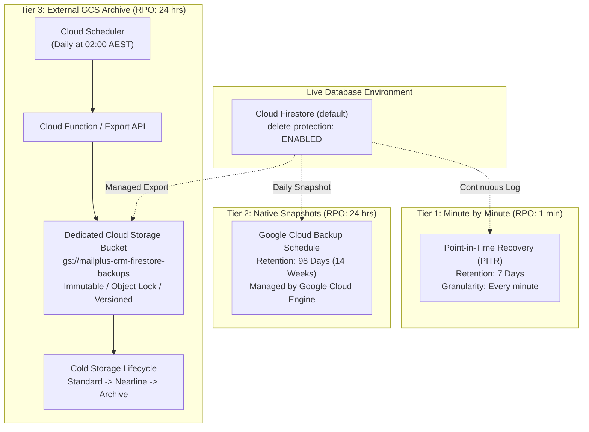

# Firestore Backup & Disaster Recovery Plan

**Target Database:** Cloud Firestore Native `(default)`  
**Project ID:** `mailplus-outbound-leads-crm`  
**Primary Region:** `nam5` (Multi-region US) / Cloud Functions: `australia-southeast1`  
**Current Date:** October 2026  
**Status:** Ready for Review & Implementation  

---

## 1. Executive Summary & Current Status Audit

During an audit of the live Google Cloud environment, we identified the current state of database protections:

| Protection Mechanism | Current Status | Current Configuration | Risk / Action Required |
| :--- | :--- | :--- | :--- |
| **Point-in-Time Recovery (PITR)** | 🟢 **ACTIVE** | `POINT_IN_TIME_RECOVERY_ENABLED` (7-day window) | Minute-by-minute rollback is already active. |
| **Native Daily Backup Schedule** | 🟢 **ACTIVE** | Schedule `14013984-b60f...` (98 days / 14 weeks retention) | Daily snapshots are actively taken and stored. |
| **Database Delete Protection** | 🔴 **DISABLED** | `DELETE_PROTECTION_DISABLED` | **Critical Risk:** Accidental deletion is not blocked. Must enable immediately. |
| **Automated GCS Cold Export** | 🟡 **MANUAL ONLY** | Single manual export in `gs://prospectplus-clone-bucket` (July 2026) | Need automated daily export to immutable Cloud Storage for cross-project disaster recovery. |

### Key Takeaway
You **already have 98 days of daily snapshots and 7 days of continuous minute-by-minute recovery** active in Google Cloud. However:
1. Delete protection is **disabled** on `(default)`, creating a risk of accidental deletion.
2. Backups have never been externalized to an automated GCS bucket with object immutability.
3. No documented disaster recovery runbook exists for restoring data without overwriting live user activity.

---

## 2. Multi-Tier Backup Architecture

A production-grade CRM backup strategy uses a **3-Tier Defense-in-Depth** model:



### Recovery Objectives Matrix

| Tier | Purpose | RPO (Data Loss Window) | RTO (Recovery Time) |
| :--- | :--- | :--- | :--- |
| **Tier 1: PITR** | Accidental document delete, bad batch script, migration glitch | **< 1 minute** | 10 – 30 minutes |
| **Tier 2: Native Backups** | Corruption noticed days later, weekly/monthly audit rollbacks | **< 24 hours** | 15 – 45 minutes |
| **Tier 3: GCS Archival** | Project compromise, compliance/legal archive, cross-cloud DR | **< 24 hours** | 30 – 60 minutes |

---

## 3. Immediate Hardening Steps (Action Items)

### Step 3.1: Enable Delete Protection on `(default)`
Prevent anyone (or any script/tool) from accidentally deleting the database from the Google Cloud Console or CLI.

```bash
gcloud firestore databases update --database="(default)" --delete-protection
```
*(When delete protection is enabled, any delete operation will fail until an admin explicitly disables this flag.)*

### Step 3.2: Verify Current Native Backups
Confirm the list of snapshots currently ready to be restored:

```bash
gcloud firestore backups list --location=nam5 --format="table(name.basename(),state,snapshotTime,expireTime)"
```

---

## 4. Tier 3 Implementation: Automated Daily GCS Export

While Native Backups protect against data corruption inside Firestore, **Tier 3 creates an independent physical copy in Google Cloud Storage** that can be moved to another Google Cloud project or downloaded locally.

### Step 4.1: Create Dedicated Backup Storage Bucket
Create a dedicated bucket with Uniform Bucket-Level Access and Object Versioning:

```bash
# 1. Create the bucket in the same multi-region (US) or primary region
gcloud storage buckets create gs://mailplus-crm-firestore-backups \
  --project=mailplus-outbound-leads-crm \
  --location=US \
  --default-storage-class=STANDARD \
  --uniform-bucket-level-access

# 2. Enable object versioning for ransomware protection
gcloud storage buckets update gs://mailplus-crm-firestore-backups --versioning

# 3. Add 90-day lifecycle rule to move older exports to Nearline/Coldline and delete after 365 days
cat << 'EOF' > /tmp/backup-lifecycle.json
{
  "rule": [
    {
      "action": {"type": "SetStorageClass", "storageClass": "NEARLINE"},
      "condition": {"age": 30}
    },
    {
      "action": {"type": "SetStorageClass", "storageClass": "COLDLINE"},
      "condition": {"age": 90}
    },
    {
      "action": {"type": "Delete"},
      "condition": {"age": 365}
    }
  ]
}
EOF
gcloud storage buckets update gs://mailplus-crm-firestore-backups --lifecycle-file=/tmp/backup-lifecycle.json
```

### Step 4.2: Grant IAM Permissions to Firestore Service Account
Allow the Firestore service agent to write export files into the bucket:

```bash
PROJECT_ID="mailplus-outbound-leads-crm"
PROJECT_NUMBER=$(gcloud projects describe $PROJECT_ID --format="value(projectNumber)")

# Grant Storage Admin to Firestore service agent
gcloud storage buckets add-iam-policy-binding gs://mailplus-crm-firestore-backups \
  --member="serviceAccount:${PROJECT_ID}@appspot.gserviceaccount.com" \
  --role="roles/storage.admin"
```

### Step 4.3: Deploy Scheduled Cloud Function for Automated Daily Export
Add a scheduled function into `functions/src/backupExport.ts` triggered daily at 2:00 AM AEST:

```typescript
import * as functions from "firebase-functions/v1";
import * as firestore from "@google-cloud/firestore";

const client = new firestore.v1.FirestoreAdminClient();

export const scheduledFirestoreExport = functions
  .region("australia-southeast1")
  .pubsub.schedule("0 2 * * *") // Daily at 02:00 AM Sydney Time
  .timeZone("Australia/Sydney")
  .onRun(async () => {
    const projectId = process.env.GCP_PROJECT || process.env.GCLOUD_PROJECT;
    const databaseName = client.databasePath(projectId!, "(default)");
    const timestamp = new Date().toISOString().replace(/[:.]/g, "-");
    const outputUriPrefix = `gs://mailplus-crm-firestore-backups/exports/${timestamp}`;

    functions.logger.info(`Starting Firestore backup export to ${outputUriPrefix}...`);

    try {
      const [response] = await client.exportDocuments({
        name: databaseName,
        outputUriPrefix: outputUriPrefix,
        collectionIds: [], // Empty array exports all collections
      });

      functions.logger.info(`Export operation triggered successfully: ${response.name}`);
      return response;
    } catch (err: any) {
      functions.logger.error("Failed to export Firestore database:", err);
      throw err;
    }
  });
```

---

## 5. Disaster Recovery & Restoration Runbooks

### Scenario A: Minor / Targeted Corruption (e.g. Someone deleted leads or messed up data 2 hours ago)
> **Goal:** Recover the deleted documents **without** wiping out transactions and edits made by other users since the mistake.

1. **Restore to a temporary database using Point-in-Time Recovery (PITR):**
   ```bash
   # Restore state from exactly 14:00 today to a temporary database 'recovery-temp'
   gcloud firestore databases restore \
     --source-database="projects/mailplus-outbound-leads-crm/databases/(default)" \
     --destination-database="recovery-temp" \
     --point-in-time="2026-10-13T03:00:00Z"
   ```
2. **Inspect and extract missing documents:**
   - Use a quick Node.js script using Firebase Admin to read from `recovery-temp` and write only the missing records back into `(default)`.
3. **Clean up temporary recovery database:**
   ```bash
   gcloud firestore databases delete --database="recovery-temp"
   ```

---

### Scenario B: Catastrophic Database Corruption or Ransomware
> **Goal:** The entire `(default)` database is damaged or compromised, and we must restore from a known-good daily snapshot.

1. **Find the best snapshot:**
   ```bash
   gcloud firestore backups list --location=nam5
   ```
   *Example output backup ID: `projects/mailplus-outbound-leads-crm/locations/nam5/backups/0d187a86-a206-4f00-97a6-68be253a6431`*

2. **Restore snapshot to a clean database:**
   ```bash
   gcloud firestore databases restore \
     --source-backup="projects/mailplus-outbound-leads-crm/locations/nam5/backups/0d187a86-a206-4f00-97a6-68be253a6431" \
     --destination-database="restored-db"
   ```
3. **Verify restored data integrity in `restored-db`** using Firestore console or admin script.
4. **Switch app traffic or sync back to `(default)`**.

---

### Scenario C: Cross-Project / Cold Import from GCS
> **Goal:** Restore into a disaster recovery GCP project or local emulator from the external storage bucket.

```bash
# Import full collection tree into any target database
gcloud firestore import gs://mailplus-crm-firestore-backups/exports/2026-10-13T02-00-00-000Z/ \
  --database="(default)"
```

---

## 6. Implementation Checklist & Recommendations

- [ ] **Action 1 (Immediate - 1 min):** Enable Delete Protection on `(default)` via `gcloud firestore databases update --database="(default)" --delete-protection`.
- [ ] **Action 2 (Low effort - 10 mins):** Create dedicated `gs://mailplus-crm-firestore-backups` bucket with 365-day lifecycle rules and object versioning.
- [ ] **Action 3 (Code - 20 mins):** Add `scheduledFirestoreExport` Cloud Function into `functions/src/` to automate daily cold exports to GCS.
- [ ] **Action 4 (Operational):** Document this runbook so the engineering and operations team can perform a PITR restore within 15 minutes of any incident.
